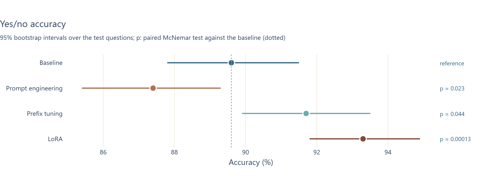
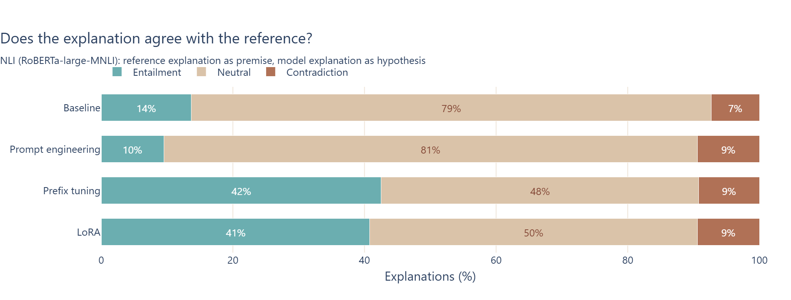
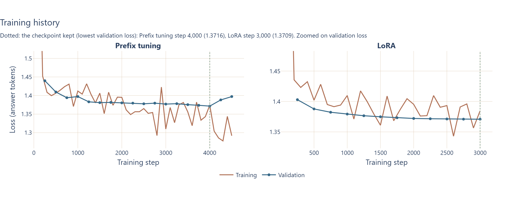
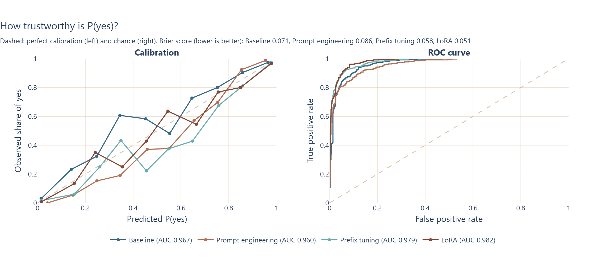
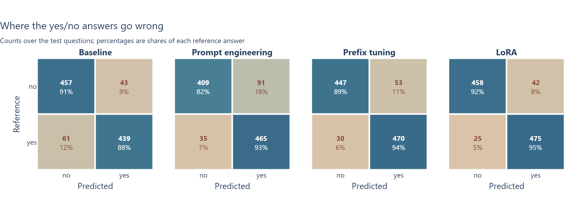
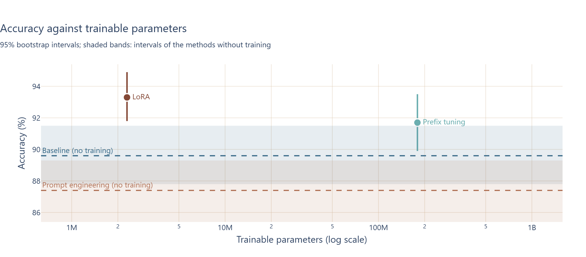

# biomedical-qa-peft

How much does parameter-efficient fine-tuning help a small open model answer biomedical
research questions? This repo compares four ways of adapting **Llama 3.2 3B Instruct**
to **PubMedQA**: the plain model (baseline), prompt engineering, prefix tuning and
LoRA. All four are scored on the same 1,000 held-out questions with a custom evaluation
framework.

**Result:** LoRA is the most accurate method (93.3% vs the baseline's 89.6%, paired
McNemar p = 0.0001). It trains 2.3 million parameters, 0.07% of the model. Both
fine-tuned methods also write explanations that agree with the reference about three
times as often as the untuned model.

<p align="center">
  
</p>

**[Browse the answers in the explorer →](https://dgelbier23.github.io/biomedical-qa-peft/explorer/)**
Four methods' answers on 100 test questions, including the ones every method gets wrong.
The question above was chosen by a fixed rule: the first sampled question where the
baseline is wrong and both fine-tuned methods are right.

## Results

All four methods answer the same 1,000 test questions, with the same decoding settings
(greedy, no repetition penalty) and scorers.

| Method | Accuracy [95% CI] | McNemar p vs baseline | Written yes/no | NLI entailment | METEOR | BERTScore | Format |
|---|---|---|---|---|---|---|---|
| Baseline | 89.6% [87.8, 91.5] | – | 79.1% | 13.7% | 0.337 | 0.819 | 88.4% |
| Prompt engineering | 87.4% [85.4, 89.3] | 0.023 | 89.3% | 9.5% | 0.334 | 0.825 | 99.9% |
| Prefix tuning | 91.7% [89.9, 93.5] | 0.044 | 93.5% | 42.5% | 0.274 | 0.853 | 100% |
| LoRA | **93.3%** [91.8, 94.9] | **0.0001** | 93.4% | 40.8% | 0.279 | 0.853 | 100% |

<p align="center">
  
</p>

**Findings**
- **LoRA is the most accurate method,** and the only one clearly better than the baseline
  (p = 0.0001). Prefix tuning is better (p = 0.044) and prompt engineering worse
  (p = 0.023); both survive a Holm correction for three tests but not a Bonferroni one.
  Paired tests detect these differences even where the confidence intervals overlap.
- **LoRA matches prefix tuning's validation loss with 78× fewer trainable parameters**
  and no sign of overfitting.
- **Fine-tuning improves the explanations' reasoning, not their length.** Entailment with
  the reference roughly triples (13.7% → 41–43%) and BERTScore rises. The fine-tuned
  models write explanations about half as long as the references (about 20 vs 37
  words), so recall-weighted METEOR is lower; length explains part of that gap.
- **Fine-tuning also makes P(yes) more trustworthy.** LoRA has the best ranking (ROC AUC
  0.982 vs the baseline's 0.967) and calibration (Brier score 0.051 vs 0.071).
- **Prompt engineering writes the format but not better answers.** The prompt chosen on
  the validation split raises format adherence to 99.9% and written accuracy to 89.3%,
  but its yes/no accuracy and entailment are below the baseline's.

<p align="center">
  
</p>

| Training | Trainable parameters | Best validation loss | Best step (of 6,000 / 3,000) | Time (A100) |
|---|---|---|---|---|
| Prefix tuning | 179,387,392 | 1.3716 | 4,000 (early-stopped at 4,500) | 40.8 min |
| LoRA | 2,293,760 | 1.3709 | 3,000 (still improving slowly) | 49.7 min |

<p align="center">
  
</p>

<details>
<summary><b>More figures:</b> calibration and ROC, confusion matrices, accuracy against trainable parameters</summary>

<p align="center">
  
  
  
</p>
</details>

**Limitations**
- **Single seed.** Each adapter was trained once. Prefix tuning's early-stopping point is
  sensitive to it: an earlier run with a slightly different setup stopped at step 2,500
  instead of 4,500.
- **Written answers depend on decoding.** With `repetition_penalty=1.2` the models
  over-write "yes"; with no penalty the baseline copies the template's `{yes or no}`
  placeholder in 11% of answers (counted as no answer). Headline accuracy comes from
  probabilities, so decoding does not affect it.
- **METEOR and BERTScore compare wording, not correctness.** NLI is the closest automatic
  check of reasoning, and still an approximation.
- **One dataset, one model size.** PubMedQA's artificial subset has machine-generated
  labels; results may not transfer to expert-labelled questions or larger models.

## Method

1. **Data** (`biomedical_qa_peft.data`, settings in `DataConfig`):

   | Step | Rule | Rows after |
   |---|---|---|
   | Load | PubMedQA `pqa_artificial`; context passages joined | 211,269 |
   | Validity filter | Context and long answer: ≥30 characters, ≥5 words, contain a "."; question contains "?" | 210,798 |
   | Remove duplicates | Same question and context | 210,751 |
   | Balance | 5,000 "yes" + 5,000 "no", seed 42 | 10,000 |
   | Format | Llama 3 chat template (system / user / assistant) | – |
   | Length filter | ≤ 1,024 tokens | 9,998 |
   | Split | Stratified 80/10/10, seed 42 | 7,998 / 1,000 / 1,000 |

   The dataset and tokenizer revisions are pinned, so the splits regenerate identically.
2. **Methods**: each adapts the same 4-bit (NF4) quantised base model.
   - **Prompt engineering**: five candidate system prompts; the most accurate on the
     validation split is used. No weight updates.
   - **Prefix tuning**: 20 learned virtual tokens, generated by a small MLP during
     training (PEFT `prefix_projection`). That trains about 179M parameters (5.6%);
     only the resulting 1.15M prefix values are saved.
   - **LoRA**: rank-8 adapters (alpha 16, dropout 0.05) on the attention query and value
     projections. That trains and saves 2,293,760 parameters (about 0.07%).
3. **Training** (`biomedical_qa_peft.training`, settings in `training/config.py`): learning
   rate 2e-5, 3 epochs, effective batch 4 (prefix tuning) or 8 (LoRA). Each training
   example is exactly the test prompt followed by the reference answer, and the loss
   covers only the answer. Validation loss is checked every 250 steps; training stops
   after 2 checks without improvement, and the checkpoint with the lowest validation
   loss is kept.
4. **Evaluation** (`biomedical_qa_peft.evaluation`, settings in `InferenceConfig`):
   - **Short answer**: yes/no read from the model's next-token probabilities after
     "Simplified Answer:". Deterministic, with no LLM judge. Reported as accuracy and
     weighted precision/recall/F1, with paired McNemar tests against the baseline.
   - **Written accuracy**: how often the yes/no the model writes in its answer matches
     the reference.
   - **Long answer**: up to 150 tokens, greedy. The explanation after "Detailed Answer"
     is scored with NLI (RoBERTa-large-MNLI, the reference as premise and the answer as
     hypothesis), METEOR and BERTScore.
   - **Format adherence**: "Simplified Answer: yes/no" followed by "Detailed Answer: ...",
     in any style (markdown bold, capitals or braces).
   - **Uncertainty**: 95% bootstrap confidence intervals over the test questions (1,000
     resamples, seed 42).

   Every run saves its predictions and a `results.json` with the summary, intervals,
   prompt, decoding settings, library versions, GPU and git commit.

## What changed from the dissertation, and why

This project began as my BSc dissertation (2025). I ported the original code, reproduced
its results within sampling noise (git tag [`v1-reproduction`](../../tree/v1-reproduction)),
and then fixed the problems listed below. Under the original evaluation the fine-tuned
methods came last (71% and 64% accuracy); with the fixes they come first.

| # | Problem in the original | Fix |
|---|---|---|
| 1 | `no_repeat_ngram_size=2` banned the second "Answer:", so the required format was impossible (0% adherence for every method) | Greedy decoding without n-gram bans |
| 2 | Prefix tuning's training text started with two `<\|begin_of_text\|>` tokens; tests had one | Training examples are built from the exact test prompt |
| 3 | NLI joined reference and answer with BERT's `[SEP]`, which RoBERTa does not use | A real premise/hypothesis pair |
| 4 | The yes/no judge was the model being evaluated (with the LoRA adapter still active) | Yes/no read from next-token probabilities; no judge |
| 5 | One sampled run per method; the prompt search used 100 rows (±12 points of noise) | Deterministic scoring, 1,000 validation rows, bootstrap intervals and McNemar tests |
| 6 | The prompt was chosen on test rows | Chosen on the validation split |
| 7 | Prefix tuning kept its final weights, not its best checkpoint (the reload failed for an MLP-generated prefix) | The best checkpoint's adapter files are copied |
| 8 | The loss covered the whole conversation, not just the answer | Prompt tokens are masked out of the loss |
| 9 | Logged training loss was twice the true value (a transformers 4.47 bug) | Upgraded libraries |
| 10 | Written answers leaned towards "yes": `repetition_penalty=1.2` penalised the " no" in the prompt's `{yes or no}` | No repetition penalty |
| 11 | NLI mostly scored the yes/no line, so a wrong yes/no read as a contradiction whatever the explanation said | NLI, METEOR and BERTScore score the explanation only |
| 12 | A new `<\|pad\|>` token resized the embeddings, so PEFT saved the whole matrix (0.8–3 GB) with every adapter | Llama 3.2's reserved `<\|finetune_right_pad_id\|>` pad token |

## Reproduce

**You need:**
- **Hugging Face access to Llama 3.2**, a gated model: request it on the model page.
- **A CUDA GPU** for training and inference: the notebooks run on Google Colab (A100
  recommended). Data processing, metrics, figures and tests run on CPU.
- **A Colab secret** named `HF_TOKEN` (your Hugging Face token). Keys are never written
  in notebook code.

**Local setup** (Windows PowerShell shown; tests run on CPU and never download Llama):

```powershell
python -m venv .venv
.venv\Scripts\python -m pip install -r requirements.txt
.venv\Scripts\python -m pip install -e .
.venv\Scripts\python -m pytest -q
```

**Run the notebooks in order.** In Colab, open them via File > Open notebook > GitHub.
The first cell of every notebook clones the latest `main`; outputs go to
`MyDrive/biomedical-qa-peft/<kind>` in Colab and `artifacts/<kind>` locally.

| Notebook | Runs on | Purpose |
|---|---|---|
| `01_environment_check` | local or Colab | versions, device, output folder |
| `02_prepare_data` | Colab (CPU is enough) | build the PubMedQA train/validation/test splits |
| `03_prompt_search` | Colab (GPU, ≈ 5 min) | choose the prompt-engineering prompt on validation |
| `04_prefix_tuning` | Colab (GPU, ≈ 40 min on A100) | train the prefix |
| `05_lora` | Colab (GPU, ≈ 50 min on A100, resumable) | train the LoRA adapters |
| `06_evaluate` | Colab (GPU, ≈ 30–40 min on A100) | evaluate all four methods on the test split |
| `07_figures` | local (CPU, needs Chrome) | draw the figures and build the answer explorer |

**Library versions** are pinned in `requirements-colab.txt` (Colab GPU) and
`requirements.txt` (local CPU): transformers 5.23.0, peft 0.21.3, accelerate 1.16.0,
bitsandbytes 0.50.2, datasets 5.2.0. Colab's preinstalled torch is used as is; the local
torch pin matches it. The dissertation's original versions are pinned at the
`v1-reproduction` tag.

## Repository layout

```
src/biomedical_qa_peft/
  data/          PubMedQA loading, preprocessing, splitting, prompt templates
  training/      prefix tuning and LoRA
  evaluation/    inference, metrics and the evaluation runner
  runtime/       environment detection, devices, seeding
  viz/           colours, Plotly theme, result figures, answer explorer
notebooks/       thin notebooks that call the package (run locally or in Colab)
tests/           CPU-only tests; never download the gated model
docs/            README figures and the answer explorer (GitHub Pages)
```

## Licences and data

- **Code**: MIT licence (see `LICENSE`).
- **Llama 3.2** is released under the Llama 3.2 Community Licence. Its weights are not
  redistributed here, and trained adapters are not published. Built with Llama.
- **PubMedQA** is released under the MIT licence. No dataset files are committed; the
  splits are regenerated from the source. The one exception is `docs/explorer/`, which
  holds 100 test questions with their abstracts and the four methods' answers.
